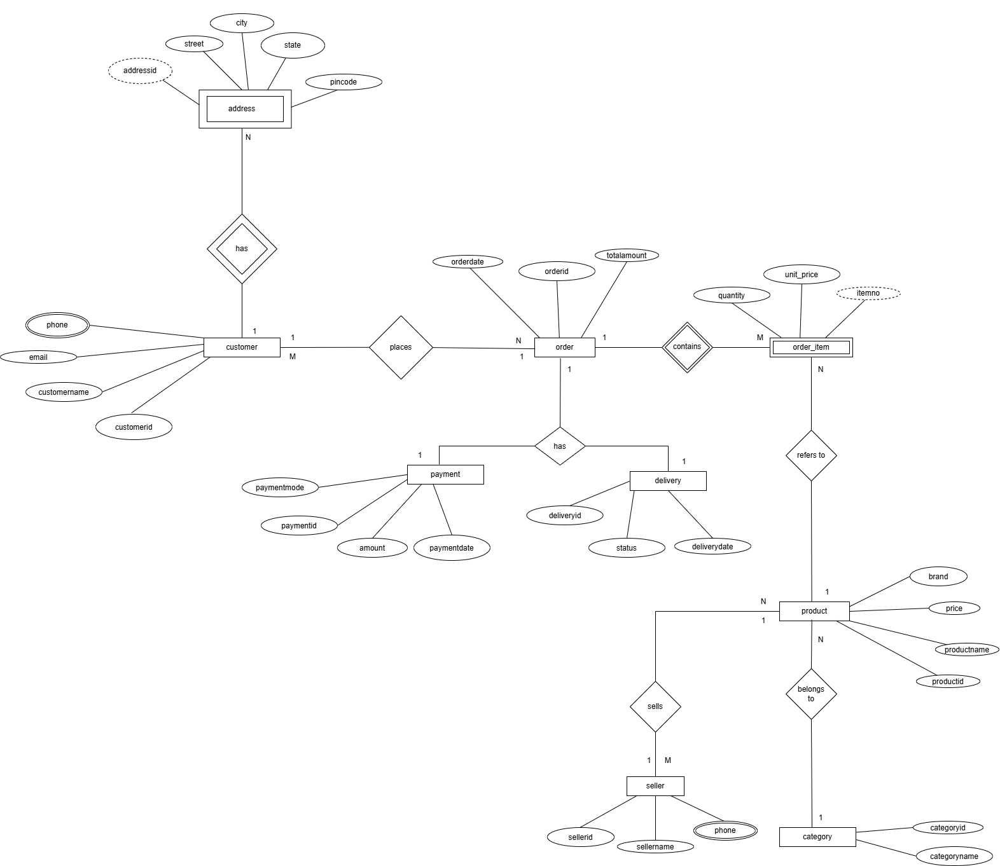

# Experiment 1: 
# ER Diagram for an Indian E-Commerce Platform

## Aim

To design an Entity-Relationship (ER) diagram for an Indian e-commerce platform and represent its entities, attributes, relationships, cardinalities, and participation constraints.

## Objectives

* Identify the entities and their attributes.
* Define primary keys and relationships between entities.
* Represent cardinality and participation constraints.
* Identify composite and multivalued attributes.
* Model weak entities and identifying relationships.
* Demonstrate specialization using physical and digital products.

## ER Diagram

The following diagram represents the ER model of the Indian e-commerce platform.

## Entities and Key Attributes

| Entity    | Example Attributes                                      |
| --------- | ------------------------------------------------------- |
| Customer  | Customer_ID, Name, Email, Phone_Number                  |
| Product   | Product_ID, Name, Price, Description                    |
| Order     | Order_ID, Order_Date, Order_Status                      |
| OrderItem | Order_ID, Product_ID, Quantity, Unit_Price              |
| Seller    | Seller_ID, Name, Email                                  |
| Category  | Category_ID, Category_Name                              |
| Payment   | Payment_ID, Payment_Method, Payment_Status, Amount      |
| Delivery  | Delivery_ID, Tracking_Number, Delivery_Status           |
| Address   | Address_ID, House_Number, Street, City, State, PIN_Code |

*Note: These attributes provide an example schema. The final diagram should reflect the actual design and constraints implemented.*

## ER Diagram Requirements

### 1. Composite Attribute

Represent the customer's address using components such as:

* House Number
* Street
* City
* State
* PIN Code

### 2. Multivalued Attribute

Represent the customer's phone numbers as a multivalued attribute.

### 3. Weak Entity

Model `OrderItem` as a weak entity dependent on `Order`, using an identifying relationship and an appropriate partial key.

### 4. Specialization

Specialize `Product` into:

* Physical Product
* Digital Product

Show the specialization constraints where applicable.

### 5. Relationships and Cardinality

Represent the relationships between customers, orders, products, sellers, categories, payments, deliveries, and addresses. Label the appropriate cardinalities and participation constraints.

## Conclusion

The ER diagram provides a conceptual representation of an Indian e-commerce platform and establishes the foundation for converting the design into a relational schema in Experiment 2.
